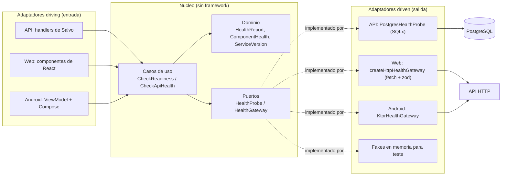

# Arquitectura

Gastonomo son tres aplicaciones que comparten una misma forma de organizar el codigo:
arquitectura hexagonal, tambien llamada puertos y adaptadores. Este documento la explica
una vez y luego dice como se aplica en cada una.

## La idea en un parrafo

El nucleo de cada aplicacion (dominio mas casos de uso) no sabe nada del mundo exterior.
No conoce HTTP, ni SQL, ni React, ni Android. Cuando necesita algo de fuera declara una
interfaz, que es el puerto. Quien sabe hablar con el mundo exterior implementa ese puerto,
y eso es el adaptador. El resultado es que se puede cambiar Salvo por otro framework,
PostgreSQL por otra base de datos o Compose por otra UI sin tocar una linea del nucleo.

Los adaptadores son de dos tipos:

- Driving (de entrada): alguien de fuera invoca un caso de uso. Un handler HTTP, un
  componente de React, un ViewModel de Android.
- Driven (de salida): el caso de uso invoca a alguien de fuera a traves de un puerto. El
  adaptador de PostgreSQL, un cliente HTTP.

La direccion de las dependencias siempre apunta hacia dentro: el nucleo no importa a nadie.

## El diagrama



## Como se fuerza, no solo se documenta

Una convencion de carpetas se rompe sola en tres semanas. Aqui la direccion de las
dependencias es estructural y ademas la vigila una herramienta.

| App     | Separacion estructural                                     | Verificacion automatica                               |
| ------- | ---------------------------------------------------------- | ----------------------------------------------------- |
| API     | Un crate de Cargo por capa                                 | Test de arquitectura que lee `Cargo.lock`             |
| Web     | Una carpeta por capa dentro de `src`                       | `eslint-plugin-boundaries` con denegacion por defecto |
| Android | Un modulo de Gradle por capa, el nucleo en `kotlin("jvm")` | Tests de Konsist mas el propio classpath              |

En la API el grafo de dependencias de Cargo hace imposible que `gastonomo-domain` importe
`gastonomo-http`. En Android el nucleo es Kotlin puro, asi que el SDK de Android ni
siquiera esta en su classpath: `import android.util.Log` en el dominio no compila. En la
web no hay barrera del compilador, asi que la pone ESLint: un import de `src/domain` hacia
`src/infrastructure`, o hacia cualquier paquete de npm, es un error de lint.

## Como se ve en cada app

### API (apps/api)

Cinco crates, uno por capa:

```
crates/domain          Agregados y value objects. thiserror, chrono, rust_decimal, uuid.
crates/application     Puertos y casos de uso. Sin framework, sin SQL, sin HTTP.
crates/infrastructure  Adaptadores driven: config, SQLx, correo, Frankfurter, seguridad.
crates/http            Adaptador driving: DTOs, handlers de Salvo, router, OpenAPI.
crates/api             Composition root: el unico sitio donde se construyen adaptadores.
```

El caso de uso `CheckReadiness` recibe un `HealthProbe` y devuelve un `HealthReport` del
dominio. En produccion el puerto lo implementa `PostgresHealthProbe`, que hace `SELECT 1`
con timeout. En los tests lo implementa `FakeHealthProbe`, que responde lo que le digas.
El resto del dominio sigue el mismo molde; el contrato completo esta en
[api-surface.md](api-surface.md).

**Hay mas de un adaptador driving, y conviene verlo.** El router HTTP es el obvio, pero no
el unico:

- `ExchangeRateScheduler` es un bucle de tokio que despierta a sus horas y llama al caso de
  uso `RefreshExchangeRates`. Es una entrada al nucleo igual que un handler, solo que la
  dispara un reloj en vez de una peticion. Por eso el caso de uso se prueba sin red y sin
  esperar doce horas.
- `Idempotent` envuelve un handler y repite la respuesta de un reintento. Vive en `http`
  porque repetir una respuesta ya emitida es transporte, no negocio; el almacen si es un
  puerto de `application`.
- El catcher de `problem+json` traduce los 404 y 405 que genera Salvo antes de que ninguna
  peticion llegue a un handler.

### Web (apps/web)

Cinco carpetas dentro de `src`, una por capa:

```
src/domain           HealthReport y HealthCheck. Sin imports externos, ni siquiera zod.
src/application      Puerto HealthGateway y caso de uso checkApiHealth.
src/infrastructure   createHttpHealthGateway (fetch, zod, timeout) y createInMemoryHealthGateway.
src/ui               Componentes de React. Reciben el puerto por contexto.
src/app              Composition root, App y main.
```

La UI nunca construye un adaptador: lo recibe. Por eso los tests de componentes montan la
pantalla con el adaptador en memoria y no tocan la red.

### Android (apps/android)

Seis modulos de Gradle:

```
core:domain        Kotlin puro. HealthReport, ComponentHealth, ServiceVersion.
core:application   Kotlin puro. Puerto HealthGateway y caso de uso CheckApiHealth.
core:common        Kotlin puro. Outcome y DispatcherProvider.
data:health        Adaptador driven: KtorHealthGateway, DTOs y mapeadores.
feature:health     Adaptador driving: HealthViewModel y pantalla de Compose.
app                Composition root (AppContainer) y tema.
```

`feature:health` no depende de `data:health`. Ambos se encuentran solo en `app`, que es
quien cablea el grafo.

## El unico caso de uso de este primer corte

Comprobar la salud del servicio. No hay entidades de negocio inventadas: cuando llegue el
dominio real, el esqueleto ya esta montado y los huecos estan a la vista.

El contrato que comparten los tres:

```
GET /health/live    200 siempre. No consulta dependencias.
GET /health/ready   200 si todo va bien, 503 si algo esta degradado.

{
  "status": "ok" | "degraded",
  "checks": [{ "name": "database", "status": "ok" | "error", "latencyMs": 12 }],
  "version": "0.1.0"
}
```

## Anadir una funcionalidad nueva

El orden es siempre el mismo, en las tres aplicaciones:

1. Modela el concepto en el dominio, con sus reglas y sus tests.
2. Si el caso de uso necesita algo de fuera, declara un puerto en la capa de aplicacion.
3. Escribe el caso de uso contra el puerto, y testealo con un fake.
4. Implementa el adaptador driven en infraestructura o en el modulo de datos.
5. Conecta el adaptador driving (handler, componente o ViewModel).
6. Cablealo en el composition root. Es el unico fichero que conoce a todos.

Si en el paso 3 te hace falta importar algo del paso 4, el diseno esta mal y la
herramienta te lo va a decir antes que el reviewer.
